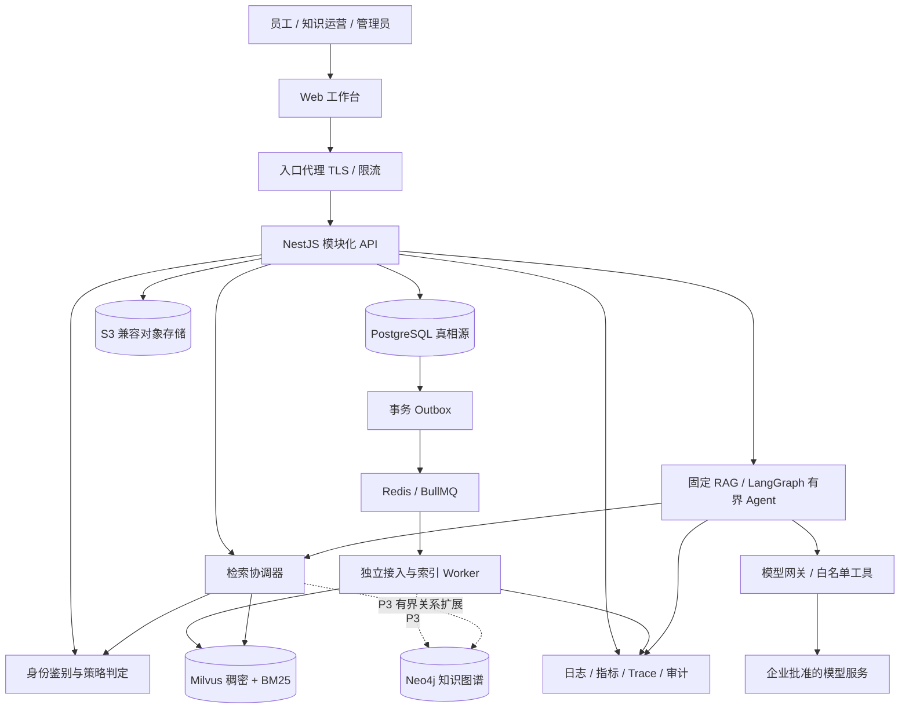
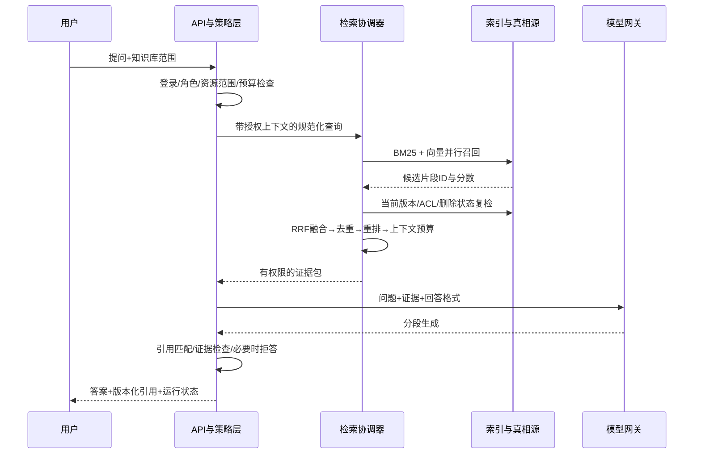

# 架构设计与技术选型

版本：0.1 设计基线｜2026-11-06｜所有容量、效果和延迟均为待验证假设，不是已实测结果。

## 1. 对参考图的继承与补齐

保留「数据接入 → 解析与分块 → 向量/图谱 → 检索融合 → Agent → 带引用回答」主干。原图属于逻辑概念图，不能直接当作生产部署图。补齐六条贯穿链路：身份与权限、版本与删除、异步一致性、评测与反馈、成本与可观测性、部署与恢复。

需要区分两种混合：**第一层是关键词 BM25 + 向量语义检索**，用于既找到精确编号又识别同义表达；**第二层是文档检索 + 图关系扩展**，用于跨文档关系问题。图谱不是每次请求的必经环节。简单制度问答走固定 RAG，明确需要关系推理时才启用图工具。

Agent 也不是“大模型调用”的别称。固定 RAG 的步骤由程序决定；Agent 可以在受控范围内选择工具、根据工具结果调整下一步并终止。第一阶段先获得稳定的检索基线，再增加有限的自主决策。

## 2. 场景与容量假设

| 项目 | 首轮设计假设 | 扩容/重新评估触发点 |
|---|---|---|
| 客户形态 | 一个企业部署，组织内多个工作空间；模型保留 tenant_id | 开始跨企业共享基础设施时重新威胁建模 |
| 员工与活跃 | 100–500 员工、100 日活 | 真实并发与部门隔离需求超过试点 |
| 文档 | 10,000 份，平均 20 个片段，约 200,000 chunks | 100 万片段或更新窗口不能满足 |
| 文件 | PDF、DOCX、Markdown、TXT；表格先保持表头与行语义 | OCR、多语言复杂版式单独评估 |
| 交互 | 20 路并发，稳态 1 QPS / 峰值 5 QPS 问答 | 持续负载下 P95 或预算失败 |
| 数据时效 | 手动上传 5 分钟内可检索；连接器默认 15 分钟轮询 | 强实时业务要事件驱动接入 |
| 安全 | 所有文档内部使用，敏感级别限制模型路由 | 外部分享、跨境处理另立需求 |

上述假设只是确定初始复杂度的工具。首个任务要用 100 份真实脱敏文档和 100 个业务问题校准。设计稿出现的数量、姓名、金额、成功率都是虚构样例。

## 3. 逻辑架构

**真相源原则：** PostgreSQL 决定文档是否存在、当前发布版本、ACL 和删除状态。Milvus、Neo4j 都是可以重建的派生索引，不能独立决定访问权。对象存储只保存源文件与解析产物，不授予永久公共链接。Redis 不保存唯一业务真相。

## 4. 服务边界：先模块化单体，再按压力拆分

API 和 Worker 独立进程、可独立扩容，但共同使用清晰的领域契约。首版不引入服务网格、Kafka 或大量微服务，减少学习期间的分布式排障成本。

| 领域模块 | 责任 | 不应承担 |
|---|---|---|
| Identity / Workspace | 登录、成员、组织、角色、工作空间边界 | 不把客户端 tenant_id 当信任来源 |
| Policy | 角色能力 + 资源 ACL + 数据密级 + 当前身份 | 不把提示词当授权规则 |
| Knowledge | 知识库、源文件、版本、发布、归档与删除 | 不同步执行耗时解析 |
| Ingestion | 连接器、任务状态、解析、分块、索引代际 | 不直接覆盖已发布版本 |
| Retrieval | 查询规范化、BM25/向量、融合、重排、授权复检 | 不返回未经授权的调试详情 |
| Conversation | 会话、消息、流事件、引用、反馈 | 不用会话 ID 代替所有者鉴权 |
| Agent | 版本化图定义、工具预算、checkpoint、审批 | 不执行任意 Shell 或无限循环 |
| Evaluation | 测试集、固定快照、实验、指标与发布门禁 | 不只凭 LLM 裁判评分上线 |
| Operations | 配额、模型路由、告警、审计、恢复任务 | 不在普通日志记录全文和密钥 |

只有当 OCR/embedding 消耗独立 GPU、检索吞吐与 API 明显分离或团队边界稳定时，才把相应模块拆为独立服务。拆分前必须已有 trace_id、幂等和契约测试。

## 5. 技术选型决策

| 层 | 默认选择 | 选择原因 | 替代及切换条件 |
|---|---|---|---|
| 前端 | React + TypeScript + Vite，Ant Design 组件基础 + 自定义设计 token | 企业表单/表格成熟，前后端同语系，内网工作台无需 SEO | Vue 团队可用 Vue + 同级组件库，不改变 API |
| 服务端 | NestJS + TypeScript，REST + SSE | 用户参考图基线；模块、依赖注入、Guard 便于学习职责分离 | 团队主力 Python 时可用 FastAPI，但不混写业务真相 |
| 工作流 | BullMQ + Redis | 重试、延迟、并发控制；适合解析/索引后台作业 | 大型事件流/多订阅系统再评估 Kafka |
| 关系数据库 | PostgreSQL + 明确 SQL 迁移，Prisma 候选 | 事务、约束、JSON、RLS；模型结构可审计 | ORM 是否启用以 RLS 事务上下文兼容性试验决定 |
| 对象存储 | 企业现有 S3 兼容服务优先 | 大文件与数据库分离，生命周期与版本化 | 本地演示可用 S3 兼容开发存储；生产另核许可/维护状态 |
| 向量与词法 | Milvus，稠密向量 + BM25，中文 analyzer 实验确认 | 与参考图一致，可同引擎做混合召回 | 小型个人实验可 PostgreSQL + pgvector；复杂全文需求可 OpenSearch |
| 图数据库 | Neo4j，P3 引入 | 可表达实体关系与有界路径，便于来源追溯 | 如果关系问题没有实测收益，延后而不是强行上线 |
| Agent | LangGraph JS；LangChain 只用于必要适配器 | 图状态/持久化/中断适合显式控制 | 简单问答用普通服务函数；不用框架包装每一步 |
| 文档解析 | 可替换 ParserAdapter；先原生文本解析，OCR 独立 Worker | 先保护页码、标题、表格和来源映射 | 专用解析服务需用复杂 PDF 基准评估 |
| 模型 | 统一 ModelGateway；生成/embedding/reranker 分开配置 | 允许私有化或经批准 API，避免供应商绑定 | 不预先宣称某模型最优，按中文业务评测选择 |
| 身份 | 企业 OIDC 优先，SAML 由身份代理转换 | 复用组织身份与离职撤权 | 本地账号仅开发/受控应急管理员 |
| 可观测性 | OpenTelemetry + Prometheus/Grafana；结构化日志 | 跨 API、队列、工具、模型关联 | 已有企业监控可直接接入 |
| 部署 | 开发 Docker Compose；生产按现有容器平台 | 控制起步成本；不为练习引入 K8s 复杂度 | 已有 K8s 团队则使用其命名空间与运维规范 |

精确版本在实施任务中锁定到受支持版本，写兼容性矩阵与 lockfile；本文件不把“最新版本”作为不变要求。Neo4j 企业能力、模型权重、解析器、存储产品许可需要实施前逐项确认，不默认所有高级功能免费。

当前官方文档确认 Nest 支持 BullMQ 集成；Milvus 提供 BM25 与多向量混合检索；LangGraph 的持久化与中断支持可恢复执行。这些是选型依据，不是本项目性能保证。[Nest 队列](https://docs.nestjs.com/techniques/queues) · [Milvus 全文](https://milvus.io/docs/full-text-search.md) · [Milvus 混合检索](https://milvus.io/docs/multi-vector-search.md) · [LangGraph 持久化](https://docs.langchain.com/oss/javascript/langgraph/persistence)

## 6. 离线接入流程

1. **登记来源。** 用户选知识库、密级、可见范围、处理配置；服务端校验配额、文件类型和大小，创建 source + document + version。
2. **隔离接收。** 文件进入隔离区；计算 hash、扫描恶意内容、限制压缩展开和解析时长；未通过不得进入索引。
3. **解析归一。** 提取标题、页码、段落、表格、图片说明；保留字符偏移或页内 bbox；OCR 置信低进入人工检查。
4. **语义分块。** 起点 400–800 tokens、10–15% overlap，标题继承；表格保留表头。该区间是实验起点，需要用问题集优化，不能固定按字符切割所有格式。
5. **索引构建。** 记录 parser/chunker/embedding/analyzer 版本，建立新的 index_generation；embedding 用批处理和缓存，但缓存必须分租户并包含模型版本。
6. **质量预检。** 比较页数、空白率、片段数量、来源定位完整度；人工抽样。图抽取只能使用已批准版本。
7. **发布切换。** 所需索引就绪后事务更新 active_generation。未完成代际不参与线上检索；失败不会替换旧的可用版本。
8. **同步与删除。** 用源端游标/更新时间 + 内容 hash 检测变化；删除先写 tombstone 撤销可读资格，再异步清索引与对象，周期核对修复漏删。

队列按“至少一次”交付设计。任务键由 tenant + version + pipeline_version + stage 构成；每一步必须可重复执行。Outbox 将业务事务与“待发事件”同时提交，独立 dispatcher 发往队列，Worker 用 inbox/唯一约束去重。不能宣称数据库与队列天然原子。

## 7. 在线检索与回答

默认初值：向量 top50、BM25 top50，按 chunk_id 合并，用 RRF 的排名融合而非直接相加不同尺度分数；去重后候选约 30–50，reranker 选 5–10 个证据块，按上下文预算再裁剪。公式为 Σ 1/(k+rank)，k 初值 60，仅为待调参数。RRF 是候选融合，cross-encoder reranker 是查询与候选的再次相关性判断，两个步骤不要混为一谈。

ACL 既进入索引预过滤，也在进入模型前用真相源复检；预过滤失效不会越权，只可能召回不足。引用展开、导出、历史答案再次访问仍需检查当前权限。默认不把高密级正文发送至不获批准的模型供应商。

问答需区分：有证据回答、部分有证据回答、需要澄清、没有足够资料、依赖暂不可用。检索分数不是概率，不在普通用户界面显示“98% 正确”。“带引用”也不等于“引用支持该句”，评测要验证句子与来源的支持关系。

## 8. 图谱设计：关系索引而非绝对真相

从一个狭窄领域起步：Product、Project、Department、PersonRole、Policy。边如 OWNS、DEPENDS_ON、APPLIES_TO、SUPERSEDES；每条事实有 source_chunk_id、document_version_id、valid_from/to、extractor_version、review_status。模型抽取形成候选事实，关键事实由知识运营审核。姓名别名不自动合并不同人员；冲突事实并存且记录来源。

图检索只允许服务端预定义参数模板，限制 1–2 跳、节点/边数量、超时和关系类型。每条用于展示或回答的路径必须有完整授权的证据支持；不通过无权中间节点推导可泄露的关系。不得让模型直接产生任意 Cypher 执行。全文事实回溯到原文，图聚合摘要也需要权限和代际隔离。

引入门槛：至少 30 个经过标注的多跳问题，图增强在固定测试集上提高目标指标，且增加的延迟/抽取成本在预算内；无收益时保留普通混合 RAG。[Neo4j 向量索引官方资料](https://neo4j.com/docs/cypher-manual/current/indexes/search-indexes/vector-indexes/)表明图系统也具备相似检索能力，本项目仍选择 Milvus 作为文档检索主索引，以保持职责清晰。

## 9. Agent 设计与学习重点

状态对象包含 run_id、workspace_id、actor、query、allowed_scope、evidence_refs、tool_results、step_count、token_budget、deadline、approval_ref、terminal_status。只保存可审计的操作事件和必要摘要，不展示或持久化模型隐藏推理链。

图节点：输入校验 → 意图分类 → 选择固定RAG/关系检索 → 工具执行 → 证据检查 → 回答/澄清/中止。检索不足最多重写一次；工具最多 6 次；总执行最多 60 秒；预算耗尽返回可解释状态。数值均为试点初值。

| 工具 | 输入约束 | 输出约束 | 权限与副作用 |
|---|---|---|---|
| search_knowledge | query、已授权 kb_ids、top_k 上限 | 片段ID、来源、有限摘要 | 只读，服务端注入租户与用户 |
| read_citation | citation_id、页码范围 | 限长原文+版本 | 只读，再鉴权 |
| expand_graph | entity_id、白名单关系、max_hops≤2 | 有来源的有限路径 | P3，只读，节点与边都鉴权 |
| compare_versions | 两个已授权 version_id | 差异与引用 | 只读，保护未发布草稿 |
| propose_document_update | 草稿内容、证据引用 | 待审批 change_request_id | P3，仅生成草稿，发布需独立批准 |

模型不接受用户直接传入的 tenant_id、工具凭据或任意 URL。工具适配器验证 schema、限长、限时、出站域名和资源权限。MCP 若后续启用，只是工具协议入口，不能替代权限策略或审批。

审批绑定不可变的动作 payload hash、资源版本、申请人与过期时间；批准后变更参数需要重新审批。LangGraph 恢复可能重新执行节点，副作用必须使用幂等键并分离审批节点与执行节点。[LangGraph 中断文档](https://docs.langchain.com/oss/javascript/langgraph/interrupts)

短期记忆是当前会话状态；长期记忆是用户明确授权保存的偏好等业务数据。首版仅保留会话上下文，禁止默认把所有聊天沉淀为跨用户记忆。checkpoint 具有租户边界、保留期、删除流程，不能用默认内存存储承担生产恢复。

## 10. 部署、容量与成本

开发环境参考 8 核/32GB 内存、SSD；不含本地大模型 GPU。这只是容纳多个服务的起点，Milvus 依赖和 OCR 峰值需实测，低配电脑使用远程开发服务。生产试点参考 API 2 实例、Worker 2 实例，数据库、Redis、对象存储和索引使用有备份的独立服务；是否高可用由业务 SLO 决定，不能把单机 Compose 称为高可用。

容量公式：原始 dense 向量字节数 = chunks × dimension × 每维字节。200,000 × 1,024 × 4 ≈ 0.82GB（十进制），不含索引、稀疏向量、元数据、副本、缓存与备份。生产磁盘与内存必须根据真实索引类型压测，不用此值直接采购。

成本模型按月记录：生成输入 tokens×输入单价 + 输出 tokens×输出单价 + embedding tokens×单价 + rerank 请求/文本量 + OCR 页数 + 存储/网络/计算/运维人工。价格填写实施时供应商实际报价，不在计划里虚构现价。对每个工作空间配置日预算、请求速率与并发上限，限额前提醒，达到硬限额中止新运行。

## 11. 架构决策记录 ADR

| ADR | 决策 | 代价 | 复审条件 |
|---|---|---|---|
| 001 | PostgreSQL 为真相源，索引可重建 | 多存储一致性和重建成本 | 数据主权与强隔离变化 |
| 002 | 单体模块 + 独立 Worker | 初期共享发布节奏 | 模块吞吐/团队形成独立边界 |
| 003 | 先 BM25+向量，再图增强 | 关系能力晚于基础问答 | 多跳评测证实收益 |
| 004 | Graph 有界 Agent，默认只读 | 自主性受限 | 具体业务需要写动作并具备审批与幂等 |
| 005 | 中文桌面主端，移动端查阅优先 | 手机不做复杂编排 | 真实移动运营需求出现 |
| 006 | 模型可替换，版本化评测发布 | 多适配与回归成本 | 单一私有模型成为组织标准 |

## 12. 实施前必须验证的技术 Spike

用 2–3 人日分别回答：①中文 BM25 analyzer 是否保留产品编号与术语；②Node 客户端是否完整支持所选 Milvus 版本的混合检索与过滤；③LangGraph JS checkpoint 与现有数据库连接池是否适配；④复杂 PDF 的引用定位是否稳定；⑤RLS 在连接池复用下是否泄露租户上下文；⑥文档撤权后旧会话、缓存、图谱和流事件是否均停止提供来源。每个 Spike 要有样本、观察结果、结论和失败回退，不以“能安装成功”作为验收。
