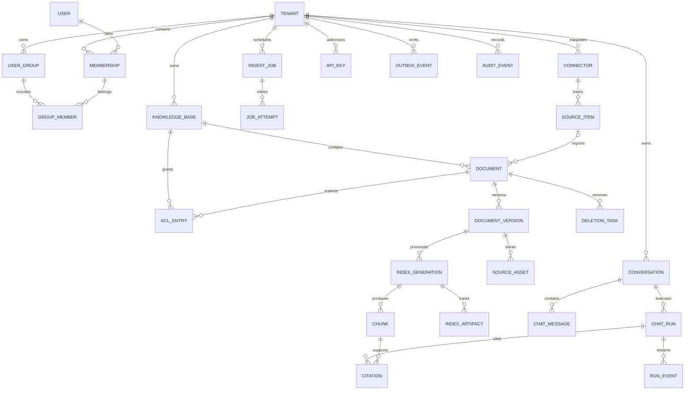

# 数据模型与 API 设计

> 状态：待实施设计草案；文中的表、约束、接口、示例、配额与时限均为本项目的建议契约，不代表功能已经实现或性能已经验证。资料核查日期：2026-11-06。首期服务单一组织，但从第一天落实租户上下文、数据归属和隔离验证；真正的多租户运营在后续阶段验收。

## 1. 阅读目标与设计边界

这一章回答四个问题：一份文件如何成为可引用知识；用户为什么只能看到自己的知识；重试、升级、撤权和删除如何保持一致；前端与 Agent 可以通过什么稳定接口完成业务。

采用 NestJS 模块化单体 + 独立异步 Worker。PostgreSQL 是业务状态、权限、发布版本、任务和审计的权威来源；对象存储保存原始文件与解析产物；Milvus 保存可重建的 dense/BM25 检索索引；Redis + BullMQ 承担缓存、并发控制和队列；Neo4j 是 P3 的派生图索引。LangGraph.js 的有界 Agent 也在 P3 接入，不改变权限和持久化边界。

阶段统一为：P0 设计、P1 基线 RAG、P2 混合检索与生产化、P3 图谱与有界 Agent、P4 上线验收。P1 先验证 dense 检索的正确闭环；P2 将 BM25 纳入混合检索发布配置，P3 才启用图索引。首轮按 100–500 名员工、1 万份文档、20 万 chunks 作设计假设，尚不是已验证容量。

三个不能混淆的概念：

- **文档 document** 是稳定的业务身份，例如“2026 差旅制度”，权限与删除作用于它。
- **文档版本 document_version** 是一次不可变内容快照，例如原文件的第 3 版，引用必须能指回这一版。
- **索引代际 index_generation** 是对某版内容采用一套解析、切块、Embedding、分词配置得到的产物。更换模型或切块规则产生新代际，不伪装成修改了原文件。

模型能力与业务事实分离：模型可以建议检索参数、归纳证据；身份、权限、当前发布版本、是否允许执行工具由服务端决定。

## 2. 概念 ER 与聚合边界



图中表达业务关联；`ACL_ENTRY` 只能绑定知识库或文档两者之一，数据库必须做互斥约束，不能因图中的两条关系误认为一条授权同时属于两个资源。文档的发布指针另以 `published_version_id` 和 `published_generation_id` 成对保存，并验证两者属于同一文档。

建议模块聚合：Identity（身份与组织）、Access（ACL 与策略）、Knowledge（知识库/文档/发布）、Ingestion（上传/解析/索引）、Retrieval（混合检索）、Conversation（会话与运行）、Governance（审计/配额）、Integration（连接器）。模块间通过应用服务和领域事件协作，不能绕过对方的权限服务直接读写业务表。

### 2.1 公共字段规范

业务主键使用服务端生成的不透明 UUID，示例中的 `doc_001` 等只是便于阅读的占位 ID。所有租户数据行必须有 `tenant_id`，时间使用 UTC 时间戳，API 使用 ISO 8601；前端按用户时区展示。可变聚合有 `row_version` 乐观锁、`created_at`、`updated_at`；软删除对象有 `deleted_at` 与 `deletion_request_id`。

跨表外键优先采用 `(tenant_id, id)` 组合关联，以数据库约束阻止跨租户引用。业务主键即使全局唯一也不能替代租户过滤。敏感配置存密钥引用，不能把外部 API 密钥直接塞进普通 JSON 字段。

### 2.2 核心数据字典

| 表/实体 | 核心字段 | 约束与查询索引 | 设计解释 |
|---|---|---|---|
| `tenant` | id、name、status、policy_version、quota_policy | id 主键 | 首期只有一个业务组织，但租户过滤不能省略 |
| `user` | id、identity_provider、subject、display_name | provider + subject 唯一 | 外部身份标识优于把邮箱当永久主键 |
| `membership` | tenant_id、user_id、role、status、authz_version | tenant + user 唯一 | 停用成员同时提升权限版本、失效会话/API Key |
| `user_group` | tenant_id、id、name、status | tenant + name 唯一 | 用户组承担部门级授权，不把组织架构写死进角色 |
| `group_member` | tenant_id、group_id、user_id | tenant + group + user 唯一 | 增删成员触发权限版本与缓存失效 |
| `knowledge_base` | id、tenant_id、name、owner_id、status、policy_version | tenant + created_at + id | 状态 active/archived/deleted；默认不向全组织开放 |
| `acl_entry` | tenant_id、kb_id 或 document_id、principal_type、principal_id、action | 资源 + principal + action 唯一；资源二选一 CHECK | P1 仅 allow；未授权即拒绝，避免复杂 deny 合并 |
| `document` | id、tenant_id、kb_id、title、status、acl_mode、published_version_id、published_generation_id、row_version | tenant + kb + created_at + id；tenant + status | 文档元信息可修改，原内容通过新版本变更 |
| `document_version` | id、tenant_id、document_id、version_no、content_sha256、source_asset_id、created_by | tenant + document + version_no 唯一 | 内容、哈希和来源不可变；处理结果在 generation |
| `source_asset` | tenant_id、id、object_key、object_version、size、mime、sha256、scan_status | object_key 唯一；tenant + sha256 非唯一 | 不跨租户共享文件；原始字节与解析正文分别保存 |
| `upload_ticket` | id、tenant_id、actor_id、kb_id、document_id?、object_key、expected_size、expected_sha256、expires_at、status | tenant + actor + id；状态与到期时间 | signed/verified/finalized/rejected/expired；不把预签名 URL 持久化到审计 |
| `index_generation` | id、tenant_id、version_id、generation_no、pipeline_config_hash、required_artifacts、parser_version、chunker_config、embedding_model、embedding_dim、analyzer_config、status | tenant + version + generation_no 唯一 | 一套配置的独立索引产物，可重建、可回滚；必需索引集合创建后冻结 |
| `chunk` | tenant_id、id、generation_id、ordinal、text_asset_ref、text_sha256、token_count、page_start、page_end、heading_path、source_span | tenant + generation + ordinal 唯一 | 精确定位引用；不能靠答案里“第 2 页”文本猜位置 |
| `index_artifact` | tenant_id、generation_id、kind、status、expected_count、written_count、manifest_hash、storage_locator、last_error_code | tenant + generation + kind 唯一 | kind=dense/bm25/graph；记录各索引阶段完成证据 |
| `ingest_job` | id、tenant_id、document_id、generation_id、kind、status、stage、progress、attempt_count、cancel_requested_at | tenant + created_at + id；业务操作键唯一 | durable 状态保存在 PG；Redis 丢失可以补投 |
| `job_attempt` | id、tenant_id、job_id、attempt_no、worker_id、started_at、ended_at、error_code | tenant + job + attempt 唯一 | 一次业务任务多次执行可追踪，不能混淆 |
| `conversation` | id、tenant_id、owner_id、title、status、row_version | tenant + owner + updated_at + id | P1 私有会话；跨人分享后续另建授权模型 |
| `chat_message` | id、tenant_id、conversation_id、role、content_ref、parent_message_id、run_id、status | tenant + conversation + created_at + id | 原问题和回答版本保留；重新生成不覆盖旧回答 |
| `chat_run` | id、tenant_id、conversation_id、actor_id、input_message_id、output_message_id、parent_run_id、status、policy_snapshot、retrieval_config_hash、budget、usage | tenant + conversation + created_at + id | 每次生成独立运行，记录模型与检索配置 |
| `run_event` | tenant_id、run_id、seq、type、payload、created_at | tenant + run + seq 唯一 | 顺序号用于断线重放；不是模型隐式思考链日志 |
| `citation` | id、tenant_id、run_id、document_id、version_id、generation_id、chunk_id、source_span、evidence_hash | tenant + run + id 唯一 | 回答引用稳定版本；读取时仍检查当前权限 |
| `feedback` | id、tenant_id、actor_id、message_id、rating、reason_codes、comment | tenant + actor + message 唯一 | 反馈是评测输入，不直接改写事实或训练模型 |
| `connector` | id、tenant_id、type、target_kb_id、config_ref、credential_ref、status、sync_cursor、sync_lease | tenant + id；tenant + status | 凭据写入专用密钥系统，UI 仅显示掩码 |
| `source_item` | id、tenant_id、connector_id、external_id、revision、etag、source_acl_hash、document_id、last_seen_sync_id、deleted_at | tenant + connector + external_id 唯一 | 用外部稳定 ID 跟踪，不把易变 URL 当唯一身份 |
| `api_key` | id、tenant_id、service_principal_id、key_prefix、secret_hash、scopes、kb_allowlist、expires_at、revoked_at、quota_policy | key_prefix 索引；hash 唯一 | 明文只返回一次；只能调用 scope 与 ACL 交集 |
| `usage_ledger` | tenant_id、id、run_id、api_key_id?、provider、unit、reserved_amount、actual_amount、status | tenant + run + provider + unit 唯一 | 先预占后结算，失败释放，重试不重复计费记账 |
| `idempotency_record` | tenant_id、actor_id、method、route、key_hash、request_hash、resource_id、status、response_status、expires_at | tenant + actor + method + route + key_hash 唯一 | 保存响应引用和摘要；读取回放前仍重新鉴权 |
| `outbox_event` | id、tenant_id、aggregate_type、aggregate_id、aggregate_version、event_type、schema_version、payload、published_at、attempt_count | published_at + created_at；聚合版本索引 | 业务修改与事件写入同一 PG 事务 |
| `consumer_receipt` | tenant_id、consumer_name、event_id、completed_at | tenant + consumer + event 唯一 | 消费端幂等凭据，队列“收到过”不等于业务完成 |
| `audit_event` | id、tenant_id、actor_id、action、resource_type、resource_id、decision、reason_code、request_id、occurred_at | tenant + occurred_at + id；resource + time | 审计记录操作和访问决定；正文、密钥和完整提示词默认不入日志 |
| `deletion_task` | id、tenant_id、document_id、tombstone_version、status、targets_manifest、completed_targets、next_retry_at | tenant + document + tombstone_version 唯一 | 跟踪源文件、切块、索引、缓存、图谱、临时产物清除 |

外部索引保存的最小定位字段：`tenant_id, kb_id, document_id, version_id, generation_id, chunk_id, policy_bucket_ids, active_hint`。这些字段是查询优化提示，**不能替代 PostgreSQL 权限与发布状态检查**。Milvus 不负责确认“谁现在可以看”；Neo4j 中的节点、边及证据也遵循同一规则。

## 3. 租户、角色、ACL 与数据可见性

### 3.1 身份与租户从哪里来

Web 使用同源前端/BFF + 服务端 Session，Cookie 设置 HttpOnly、Secure、合适的 SameSite；写操作校验 CSRF Token 与 Origin。服务端从已认证 Session 得到用户、当前组织与成员状态。切换组织必须验证 membership，不能信任请求 body、URL 或 `X-Tenant-Id` 自称的租户。

外部 API 使用 Bearer API Key，映射到不可超越授权范围的服务主体；禁止把管理员本人权限隐式继承给一个新 Key。Worker 任务携带服务端签发的租户/资源上下文，开始执行与外发前复核资源状态；不会信任上传正文或模型工具参数中的 `tenant_id`。

PostgreSQL Row-Level Security 可提供行级防线，但表拥有者等角色可能绕过常规策略。因此运行时数据库账号必须非 owner、无 BYPASSRLS，租户表启用合适策略，并在连接池事务中设置和清理上下文；迁移账号与运行账号分离。应用层仍检查资源授权。[官方依据：PostgreSQL 行安全策略](https://www.postgresql.org/docs/current/ddl-rowsecurity.html)

### 3.2 角色与资源能力

| 角色/身份 | 默认能力 | 不能仅凭角色获得的能力 |
|---|---|---|
| 员工 `employee` | 被授权知识的搜索、问答、预览与引用查看 | 源文件下载需额外 `download`；不能修改文档 |
| 知识运营 `knowledge_operator` | 被授权库的上传、版本、重试、元信息编辑；按资源授权发布、删除或管理库 | 无权管理其他库或服务密钥；发布、管理 ACL 等高权限需显式授予 |
| 工作空间管理员 `workspace_admin` | 成员、用户组、组织策略、服务 Key、审计与配额管理；被授权库的配置 | 默认不自动阅读所有私密知识；内容仍需 ACL，紧急访问需单独审批与审计 |
| 审计者 `auditor` | 查看脱敏的审计与用量 | 不因审计身份获得文档正文和他人的完整会话 |
| 服务主体 `service_principal` | scopes、知识库白名单和 ACL 三者交集 | 不继承 Key 创建人的所有内容权限 |

资源动作定义：`read`、`download`、`write`、`publish`、`manage_acl`、`delete`。`download` 不自动等于 `read` 的副作用；有权检索摘要与有权导出全文可以是不同政策。

P1 的 ACL 合并规则：

1. 先验证租户、成员有效状态和角色允许调用该操作。
2. 知识库必须具有该用户/用户组/服务主体对应的能力。文档 `acl_mode=inherit` 时继承库授权。
3. 文档 `acl_mode=restricted` 时，在库授权基础上再要求文档 ACL。文档授权只能收紧，不能越过库边界扩大权限。
4. 同一资源的多个 allow 取并集；跨层范围取交集；不支持显式 deny。以后引入 deny 必须新增优先级设计与回归矩阵。
5. 会话归属、任务归属、上传票据归属也检查；知道 ID 不等于拥有权限。

### 3.3 每次检索的权限门禁

**门禁 A：召回前。** 从 PG 计算可访问知识库、受限文档范围与当前权限版本，把租户、库、权限桶/合法文档集合过滤放入每条 dense/BM25/graph 召回。未能生成可靠过滤条件时失败关闭，不能退化为全库召回。ACL 很大时采用权限桶/分批查询并评测，禁止把无限长度 ID 列表塞入请求。

**门禁 B：外发前。** 召回仅获得候选定位 ID 和必要分数，在 PG 批量检查 tenant、未删除、当前发布二元组、当前 ACL；只加载通过校验的原文。任何外部 reranker、LLM、工具调用接收内容之前必须完成此检查。若索引陈旧造成候选不足，在同一权限边界内补召回；不允许为了凑满数量扩大权限。

**门禁 C：返回前与重放时。** 答案、引用、缓存、历史会话、SSE 重连、图实体、源文件访问都按当前权限判定。引用依赖清单中的某份文档被撤权时，受影响的历史回答默认整体隐藏并提示“依据的访问权限已变化”，不能只去掉引用却继续展示包含机密的答案。对运行中撤权，停止发送后续内容并终止受影响运行；已经发送到用户屏幕或供应商的字节无法事后收回，需在产品承诺中明确这一时序边界。

撤权事务会提升相关 `authz_version/policy_version`，使后续读请求立即按新权限拒绝；缓存失效与索引权限更新可以异步进行，但任何请求不得仅依赖失效通知。`authz_fingerprint` 包含 tenant、主体、成员版本、组版本、资源策略版本，用于缓存命中前检查。严格模式下不使用可转发的源文件下载预签名 URL，而由应用代理每次校验后输出文件；对象存储桶不公开。

### 3.4 必测权限场景

| 场景 | 期望行为 |
|---|---|
| A 租户用户提供 B 租户文档 ID | 404，既不泄露存在性也不产生跨租户日志正文 |
| 从用户组移除成员，但 Milvus ACL 字段尚未更新 | PG 门禁拦截，reranker/LLM 收不到受限正文 |
| 旧缓存命中、旧会话打开、旧 SSE 游标重放 | 全部重新鉴权，受影响答案不可读取 |
| 引用来源删除后打开历史回答 | 依照保留策略隐藏受影响正文；引用显示不可用，不偷偷换成新版 |
| API Key 被撤销或过期 | 新请求拒绝，活跃事件流在下一检查点关闭 |
| 图实体由公开与私密文件共同支持 | 只输出当前用户可见证据支持的属性与边；不能暴露“存在私密关系”的计数 |
| 下载途中撤权 | 后续分块检查尽快停止；已下载部分无法撤回 |

## 4. 文件、版本、索引与删除的一致性

### 4.1 上传与处理时序

1. 客户端向应用申请 upload ticket，说明文件名、大小、MIME、SHA-256、目标知识库与可选旧文档 ID；服务端验证权限、限额与格式，生成独立 staging key。
2. 服务端签发短期、指定 key/方法/校验头的上传 URL，建议有效期 10 分钟。不能把用户文件名直接作为对象路径，也不能允许覆盖现有版本的 key。
3. 客户端上传到对象存储，再调用 finalize。服务端使用存储元信息核验对象存在、大小、校验和、票据归属、有效期与目标权限。浏览器宣称的 MIME 和哈希不够，Worker 仍做文件嗅探与受隔离的解析。
4. 为防止同一个预签名 URL 在 finalize 后覆盖 staging 对象，服务端固定对象版本 ID，或将核验版本复制到用户不可写的唯一 immutable key。没有版本化能力的 S3 兼容存储必须验证复制前后内容一致；不能直接将仍可写的 staging key 发布。
5. PG 事务创建文档版本、索引代际、job 和 outbox；返回 202。安全检查、解析、切块、Embedding、对应阶段的索引写入与可查询性校验由 Worker 执行；隔离区内容不会进入搜索。
6. 首版必需索引完成后按发布策略切换发布指针。默认知识运营准备版本，具有 `publish` 的用户发布；可为低风险库显式启用“处理成功自动发布”，并记录服务主体操作。两种策略不能在 UI 中混成同一个不透明状态。

S3 官方说明预签名 URL 在有效期内可重复使用，并可能覆盖同 key 对象；校验和可用于上传完整性验证。因此“短期 URL”本身并不等于“一次性且不可覆盖”，上述 staging/固定版本设计是本项目增加的防护。[官方依据：S3 预签名 URL](https://docs.aws.amazon.com/AmazonS3/latest/userguide/using-presigned-url.html)

### 4.2 状态机

文档状态与处理状态分开，避免“上传新版失败”导致旧版不能使用。

| 对象 | 状态流转 | 约束 |
|---|---|---|
| document | `draft → active → archived → active`；非 deleted 状态可到 `deleted` | active 必须有有效发布指针；archived 不参与问答但授权管理员可管理；deleted 是逻辑终态 |
| index_generation | `queued → processing → ready`；可转 `failed/cancelled` | `ready` 表示 required_artifacts 全部通过清单与读验证；不表示已经发布 |
| index_artifact | `pending → building → verifying → ready`；可转 `failed` | P1 必需 dense；P2 hybrid 配置必需 dense + bm25；graph 在 P3 默认可选 |
| ingest_job | `queued → running → succeeded`；可 `retry_wait → running`；可终止为 `failed/cancelled` | 取消中用 `cancel_requested_at` 表达，终止确认后才是 cancelled |
| chat_run | `queued → running → completed`；可 `failed/cancelled`；P3 可进 `awaiting_approval` 再回 running | completed、failed、cancelled 均终态，重新生成创建新 run |
| deletion_task | `pending → running → completed`；可 `retry_wait` 或 `blocked` | blocked 必须有明确的存储故障/保留政策原因并告警，不能悄悄消失 |

### 4.3 发布与重建

一个文档仅有一个当前发布二元组 `(published_version_id, published_generation_id)`。候选代际完整可查且 manifest 校验成功后，在 PG 事务中以 `If-Match` 对应 `row_version` 作比较并交换指针，同时写入 `document.published` 事件。旧版在新版本全部必需索引成功前始终可用；索引故障不清空旧指针。

`required_artifacts` 由已批准的 pipeline profile 在创建代际时决定并冻结。P1 为 dense，P2 的 hybrid profile 为 dense + bm25；不能为了让失败任务看似成功而临时把 bm25 改成可选。从 P1 升级 P2 应建立新代际逐文档切换；迁移期某文档只有 dense 时，要么继续走明确标记的 dense 模式，要么等待 hybrid 就绪，不能悄悄声称已执行混合检索。P3 的 graph 默认为增强项，不阻塞 dense/BM25 的知识发布。

Milvus 的 `active_hint` 可以延迟更新。新代际在指针切换前即使被召回也会被门禁 B 排除；切换后旧代际同样会被排除。每次问答保存实际使用的版本、代际、配置哈希和证据。若要回滚，在旧代际仍保留且可用的前提下执行同一发布接口，显式记录回滚审计；不会重新写原文件。

更换 embedding 模型、维度、中文 analyzer 或切块策略，均新建 generation；向量维度不同使用新 collection/schema，由 manifest 标识。Milvus 提供 BM25 全文能力并可与 dense 检索结合，但本项目仍需验证所锁定版本、Node SDK、中文分词和部署形态；不能把 Lite 的能力直接当成 Standalone 的能力。[官方依据：Milvus 全文检索](https://milvus.io/docs/full-text-search.md)

历史版本保留多久由组织配置。建议演示环境保留最近 3 个已发布版本，企业环境按审批后的保留策略执行；这只是初始容量假设。不能为了节省空间删除仍被允许保留的历史引用依赖，除非产品策略明确转为“来源已不可用”。

### 4.4 Outbox、重试与补偿

PG 事务只保障自身状态与 outbox 原子性，不跨 PostgreSQL、Redis、Milvus、Neo4j 和对象存储承诺分布式事务。Outbox dispatcher 将事件投到 BullMQ；发送后崩溃可能重复投递，消费者必须幂等。

- 任务业务键示例：`tenant + generation + stage + pipeline_config_hash`；索引写入主键稳定，重复 upsert 不制造第二份切块。
- 消费者成功后的结果与 `consumer_receipt` 一起提交；外部写入先发生时，下次执行先校验 manifest 再补完 PG 状态。
- Worker 启动前、长阶段结束前和发布前复核文档 tombstone 与目标版本；陈旧任务不能将已删除文档重新上线。
- 临时网络错误采用有上限的指数退避加抖动；建议 5 次后进入人工可见失败状态。无效文件、权限拒绝、未知 schema_version 不盲目重试。
- 定期 reconciliation job 比较 PG 清单与各存储实际状态，补投缺失任务并移除孤儿对象。Redis 队列丢失后由 PG durable jobs 恢复。

BullMQ 文档要求任务在失败重试后保持同样最终结果；队列去重不替代业务幂等。本方案的 outbox、业务唯一约束与 manifest 是应用侧设计。[官方依据：BullMQ 幂等任务](https://docs.bullmq.io/patterns/idempotent-jobs)

领域事件建议字段：`event_id, schema_version, tenant_id, aggregate_type, aggregate_id, aggregate_version, event_type, occurred_at, actor_id, request_id, payload`。payload 只放引用 ID、版本与必要状态，避免把整份正文广播到各队列。起步事件包括 `document.version_created`、`generation.ready`、`document.published`、`acl.changed`、`membership.changed`、`document.deleted`、`index.cleanup_requested`、`chat_run.completed`、`quota.exceeded`。

### 4.5 删除与撤权

删除请求先在 PG 同一事务写 `deleted_at`、递增策略版本、登记 tombstone、删除任务和 outbox。202 表示**逻辑删除已经生效，物理清理仍在进行**。所有门禁立即排除它；不能等 Milvus 删除成功才对用户隐藏。

清理清单包含原文件所有需删除版本、解析文本、切块、dense/BM25、图证据、图属性、Redis 缓存、临时上传、未完成任务、受影响回答与引用的可见性记录。图中的共享实体只有在没有剩余合法证据时才删除；更稳妥的做法是先删除证据边再重算派生属性，不能把同名实体一并删掉。

源文档删除不必等同立即销毁全部审计：审计可以仅保留操作类型、不可逆摘要与删除证明，不保留正文。备份通常需要按保留周期过期，而非声称瞬时物理抹除；恢复备份时必须重放 tombstone，先恢复删除门禁再开放流量。存在法律保留需求时，应在项目启动阶段确认，不由工程代码自行猜测。

### 4.6 连接器增量同步

连接器 P1 可先只做手动上传；网页/企业文库/数据库接入按阶段开放。每个连接器有租约避免并发同步，使用 `external_id + revision/etag` 判断变更，保存分页 cursor/checkpoint。导入一批后先提交文档与任务，再推进 cursor；失败重试不得跳过未提交数据。

源系统 404/明确删除事件可触发 tombstone；一次抓取失败或一次分页缺失不能当成删除。全量同步只有完整成功后才对“未见到的条目”发起核实；源权限变更优先同步，无法可信映射 ACL 的文件进入隔离或仅管理员可见，绝不能默认公开。

网页 URL 和数据库连接只能由管理员配置白名单与受限凭据。网页抓取需限制重定向、私网地址和返回体；数据库连接器只能执行预定义、参数化、只读查询模板。Agent 不获得任意 URL、SQL 或 Cypher 执行入口。

## 5. API 总体契约

所有业务路径前缀为 `/api/v1`。下面是一份供后续生成 OpenAPI 与契约测试使用的设计清单，本阶段不生成 SDK 或服务代码。

### 5.1 请求、响应与并发规则

| 方面 | 约定 |
|---|---|
| 内容格式 | JSON 请求/响应为 UTF-8；流式为 `text/event-stream`；文件下载有独立 Content-Type |
| 资源 ID | 不透明 UUID；不能从 ID 推导租户、权限或顺序 |
| 时间 | ISO 8601 UTC；如 `2026-11-06T08:00:00Z` |
| 跟踪 | 响应 `X-Request-Id`；客户端可传合规 request ID，服务端不盲信超长/非法值 |
| 资源返回 | 单资源 `{"data": {...}}`；列表 `{"data": [], "page": {"next_cursor": null, "has_more": false}}` |
| 异步 | 202 + `job_id/run_id` + 状态 URL；202 不能标成“处理完成” |
| 幂等 | 创建/触发副作用的 POST 要求 `Idempotency-Key`；DELETE 自然幂等且接受该头；GET 不需要 |
| 乐观锁 | 可变聚合 GET 返回 ETag；PATCH/ACL 替换/发布/删除要求 `If-Match`；缺失 428，版本过期 412 |
| 业务冲突 | 409 用于状态冲突、重复活跃 run、相同幂等 key 对应不同请求、版本尚不可发布 |
| 列表分页 | `limit` 默认 20、最大 100；cursor 不透明且带签名，绑定 tenant、actor、过滤条件和排序 |
| 排序 | 稳定排序如 `created_at DESC, id DESC`；不承诺可变列表跨页绝对快照 |
| 搜索分页 | P1 top-k 查询一次返回至多 50 条，不使用普通资源列表 cursor；后续搜索会话需单独快照契约 |
| 权限失效 | 默认对不应暴露存在性的资源返回 404；显式可见管理资源的动作拒绝可返回 403 |
| 版本兼容 | 新增可选字段通常兼容；移除/改义/状态语义变化需新主版本或协商迁移 |

幂等记录建议保留 24 小时。同 actor、route、method、key，且规范化请求摘要一致时返回同一资源引用；不能重复建任务。不同摘要返回 409 `IDEMPOTENCY_KEY_REUSED`。正在受理的同键请求返回 409 `REQUEST_IN_PROGRESS` 与 `Retry-After`，或直接返回已分配资源，项目实现时固定一种策略；本计划选后者：资源已分配返回其 202，尚未分配才返回 409。记录过期后重试可能创建新操作，所以长期恢复必须依靠返回的资源 ID 查询。

幂等响应回放前仍检查当前成员与资源权限，不因保存旧响应就越过撤权。为了避免创建后崩溃导致重复，资源记录、幂等结果和 outbox 在同一个 PG 事务落库；执行副作用之前需要确定业务唯一键。

### 5.2 角色与权限缩写

API 表中的 `登录` 指有效组织成员；`R` 是 read；`E` 是 write；`P` 是 publish；`K` 是指定知识库的管理能力；`O` 是工作空间管理；`A` 是审计；`本人` 是会话/任务/票据归属。这些是能力缩写，不是新增产品角色。员工主要映射 R，知识运营按授权映射 E/P/K，工作空间管理员映射 O 并按资源 ACL 获得 K，审计员映射 A。`Key` 指 API Key 且需要对应 scope，例如 `knowledge:read`、`documents:write`、`chat:run`。浏览器会话的写请求同时需要 CSRF，表中不再重复。

### 5.3 端点清单：身份与治理（1—13）

| # | 方法与路径 | 角色/范围 | 主要请求 | 成功响应 | 关键限制与错误 |
|---|---|---|---|---|---|
| 1 | GET `/auth/session` | 登录 | 无 | 200 当前用户、当前组织、能力、CSRF token | 不返回 Session secret；401 未登录 |
| 2 | POST `/auth/logout` | 登录 | 无 | 204 撤销当前会话 | 幂等；同时关闭相关活跃事件流 |
| 3 | GET `/members` | O | cursor、status | 200 成员分页 | 最小必要个人信息；支持过滤 |
| 4 | PATCH `/members/{id}` | O | role、status | 200 成员与 ETag | If-Match；禁止撤掉最后一个工作空间管理员，409 |
| 5 | GET `/groups` | O 或 K 的授权选择器 | cursor、q | 200 用户组分页 | K 仅见授权所需名称/ID，不见无关成员隐私 |
| 6 | POST `/groups` | O | name、description | 201 用户组 | 名称冲突 409；幂等 |
| 7 | PUT `/groups/{id}/members/{userId}` | O | 无 | 204 已加入 | 自然幂等；检查双方同租户 |
| 8 | DELETE `/groups/{id}/members/{userId}` | O | 无 | 204 已移除 | 立即更新权限版本；自然幂等 |
| 9 | GET `/api-keys` | O | cursor、status | 200 Key 元信息 | 只显示前缀、scope、到期日与用量；不返回密钥 |
| 10 | POST `/api-keys` | O | name、service_principal、scopes、kb_ids、expires_at、quota | 201 Key 与仅一次明文 | 不能配置超出操作者可授予范围；幂等重放不重新暴露 secret，需撤销重建 |
| 11 | DELETE `/api-keys/{id}` | O | 无 | 204 撤销 | 自然幂等；授权缓存不得延迟继续允许 |
| 12 | GET `/audit-events` | A/O | cursor、actor、action、time_range | 200 脱敏审计分页 | 最大查询窗口；不能通过查询返回提示词正文 |
| 13 | GET `/usage` | O/A；本人可读自身 | period、group_by | 200 用量、预占与限额 | 普通主体不能看其他人费用明细 |

SSO/OIDC 的授权重定向与 callback 属身份集成专项，需要选定企业 IdP 后固定，故不在此虚构密码登录协议。首期验收可用明确标记的开发身份，但不把开发登录带到生产。

### 5.4 端点清单：知识库与文档（14—34）

| # | 方法与路径 | 角色/范围 | 主要请求 | 成功响应 | 关键限制与错误 |
|---|---|---|---|---|---|
| 14 | GET `/knowledge-bases` | 登录/Key | cursor、status、q | 200 可见知识库分页 | 先过滤权限再分页，不用 total 泄露隐藏库数量 |
| 15 | POST `/knowledge-bases` | O 或被授予创建库能力 | name、description、publish_policy | 201 知识库 | 默认私有；创建者获得明确管理授权 |
| 16 | GET `/knowledge-bases/{id}` | R/K | 无 | 200 库配置、能力、ETag | 不可见 404 |
| 17 | PATCH `/knowledge-bases/{id}` | K | name、description、status、publish_policy | 200 + ETag | If-Match；状态不允许 409 |
| 18 | GET `/knowledge-bases/{id}/acl` | K | cursor | 200 授权规则 | 不向普通 reader 暴露全组织成员清单 |
| 19 | PUT `/knowledge-bases/{id}/acl` | K/manage_acl | 完整 grants 数组 | 200 新策略版本、ETag | If-Match；禁止操作者意外移除最后一个可管理主体，409 |
| 20 | GET `/knowledge-bases/{id}/documents` | R/Key | cursor、q、status | 200 文档分页 | 仅可见文档，过滤字段白名单 |
| 21 | POST `/upload-tickets` | E/Key documents:write | kb_id、document_id?、filename、size、mime、sha256 | 201 ticket、upload_url、headers、expires_at | 413 过大、415 不支持；预留容量，避免并发超限 |
| 22 | POST `/upload-tickets/{id}/finalize` | E + 本人 | checksum、object_version? | 202 document_id、version_id、generation_id、job_id | 服务端核验；票据失效 410；对象不符 422；不得信任任意 object_key |
| 23 | GET `/documents/{id}` | R/E | 无 | 200 文档、发布版本、当前能力、ETag | 默认只显示可读元信息，管理字段按能力返回 |
| 24 | PATCH `/documents/{id}` | E | title、tags、description | 200 文档 + ETag | 不允许直接改 published 指针或原文；If-Match |
| 25 | DELETE `/documents/{id}` | delete | 无 | 202 deletion_task_id、logically_deleted=true | If-Match；后续同主体重试可得同任务；对其他主体 404 |
| 26 | GET `/documents/{id}/versions` | E/P；R 仅可读历史版本 | cursor | 200 版本分页与发布标记 | 草稿版本不能暴露给只有阅读权限的人 |
| 27 | GET `/documents/{id}/versions/{versionId}` | E/P 或有历史读取能力 | 无 | 200 版本、generation 摘要 | 校验版本确属本文档与同租户 |
| 28 | POST `/documents/{id}/publish` | P | version_id、generation_id | 200 发布二元组、ETag | If-Match；非 ready 为 409；不自动等候任务成功 |
| 29 | POST `/documents/{id}/reindex` | K 或获授权 E | version_id、pipeline_profile_id | 202 generation_id、job_id | 不接受任意模型 URL/脚本；同配置可复用已有合格代际 |
| 30 | GET `/documents/{id}/acl` | K/manage_acl | 无 | 200 acl_mode、grants、ETag | 受限文档策略不可被 reader 枚举 |
| 31 | PUT `/documents/{id}/acl` | K/manage_acl | acl_mode、grants | 200 policy_version、ETag | If-Match；restricted 只收紧库权限 |
| 32 | GET `/documents/{id}/versions/{versionId}/preview` | R + 版本可读 | page 或 chunk_id | 200 受控预览 | 不返回存储凭据；草稿仅编辑者可预览 |
| 33 | GET `/documents/{id}/versions/{versionId}/content` | download + 版本可读 | Range 可选 | 200/206 应用代理文件流 | 每请求鉴权，禁共享缓存；不使用长期直链 |
| 34 | GET `/deletion-tasks/{id}` | 发起者或 K | 无 | 200 清理进度、失败原因码 | 不返回其他租户存储路径；完成后仍保留最小删除证明 |

### 5.5 端点清单：任务、检索、会话（35—50）

| # | 方法与路径 | 角色/范围 | 主要请求 | 成功响应 | 关键限制与错误 |
|---|---|---|---|---|---|
| 35 | GET `/jobs` | 本人或 K | cursor、kb_id、status | 200 job 分页 | 不能直接枚举 BullMQ 内部队列 |
| 36 | GET `/jobs/{id}` | 本人或 K | 无 | 200 stage、progress、attempt、error | progress 是阶段估计，允许 unknown，不伪造精确百分比 |
| 37 | POST `/jobs/{id}/retry` | E/K | 无 | 202 job_id、attempt | 仅失败/允许重试状态；未完成重复操作 409 |
| 38 | POST `/jobs/{id}/cancel` | 本人且 E/K | reason? | 202 cancel_requested_at | 已终态返回 200 当前状态，不宣称取消成功 |
| 39 | POST `/search` | R/Key knowledge:read | query、kb_ids、filters、top_k、mode | 200 授权结果、引用定位、检索元信息 | top_k≤50；参数白名单；不返回原始内部权限过滤表达式 |
| 40 | POST `/conversations` | 登录/Key chat:run | title?、kb_ids? | 201 conversation | 私有归属；指定库先校验 |
| 41 | GET `/conversations` | 本人 | cursor、q | 200 自己的会话分页 | 无全组织聊天浏览能力 |
| 42 | GET `/conversations/{id}/messages` | 本人 | cursor | 200 消息分页 | 当前证据权限复核；受限回答返回占位状态 |
| 43 | PATCH `/conversations/{id}` | 本人 | title | 200 + ETag | If-Match；名称纯文本，不执行 HTML |
| 44 | DELETE `/conversations/{id}` | 本人 | 无 | 202 清理任务 | 逻辑隐藏并取消未完成 run；按保留策略清理 |
| 45 | POST `/chat-runs` | 本人/R/Key chat:run | conversation_id、message、kb_ids、mode | 202 run_id、events_url、status_url | 同会话 P1 只允许一个活跃 run；409 CONVERSATION_BUSY |
| 46 | GET `/chat-runs/{id}` | 本人 | 无 | 200 status、message_id、usage、last_event_id | 不泄露隐藏推理；已终态可读取最终快照 |
| 47 | GET `/chat-runs/{id}/events` | 本人 | Last-Event-ID 或 after | 200 SSE | 心跳、重放、实时鉴权；过期游标返回控制事件后关闭 |
| 48 | POST `/chat-runs/{id}/cancel` | 本人 | reason? | 202 取消请求或 200 终态 | 尽力中断外部模型；终态只能写一次 |
| 49 | POST `/chat-runs/{id}/regenerate` | 本人/R | override_profile_id? | 202 新 run_id、parent_run_id | 不覆盖旧消息；复用问题但重新按当前权限检索 |
| 50 | PUT `/messages/{id}/feedback` | 本人 | rating、reason_codes、comment? | 200 feedback | 每主体每消息一条，可修改；不自动传播给外部模型 |

### 5.6 端点清单：引用与后续扩展（51—58）

| # | 方法与路径 | 阶段/角色 | 主要请求 | 成功响应 | 关键限制与错误 |
|---|---|---|---|---|---|
| 51 | GET `/citations/{id}` | P1 本人且来源 R | 无 | 200 version、page、heading、授权摘录 | 引用绑定回答与版本，撤权/删除返回不可访问状态，不返回受限标题 |
| 52 | GET `/connectors` | P2 K/O | cursor、type | 200 连接器元信息分页 | 凭据全部掩码 |
| 53 | POST `/connectors` | P2 K/O | type、kb_id、config、credential_ref | 201 connector | 类型与目标白名单；测试连接不能触发无限抓取 |
| 54 | POST `/connectors/{id}/sync` | P2 K | mode=incremental/full | 202 sync_job_id | 每连接器一把租约，冲突 409 |
| 55 | DELETE `/connectors/{id}` | P2 K | 无 | 202 停止/清理任务 | 默认保留已导入文档，删除文档必须另行明确发起 |
| 56 | GET `/graph/entities/{id}/neighborhood` | P3 R | depth≤2、limit≤100 | 200 授权节点/边/证据 | 禁任意 Cypher；限跳数、数量与超时 |
| 57 | GET `/tool-approvals/{id}` | P3 指定审批人 | 无 | 200 tool、脱敏参数、影响摘要、expires_at | 只有白名单写工具需要；P1 不实现审批系统 |
| 58 | POST `/tool-approvals/{id}/decision` | P3 指定审批人 | approve/reject、expected_payload_hash | 200 decision 或 202 恢复 run | If-Match；过期/已执行/参数变化 409/410；批准不绕过执行时鉴权 |

这 58 个端点是业务能力目录，不要求在第一个迭代全部实现。先完成上传—发布—检索—问答—引用—权限闭环，P2 增强混合检索和生产治理，P3 引入图谱与受控 Agent。UI 使用哪一个页面入口由产品设计确定，这里不另设页面编号。

### 5.7 工作空间与完整管理界面契约补充（59–93）

**统一归属补充，优先于前文简化 ER：** tenant 是企业级隔离，workspace 是企业内部工作空间。新增 `workspace(id, tenant_id, name, status, timezone, settings_version)` 与 `workspace_membership(tenant_id, workspace_id, user_id, role, status, authz_version)`；tenant membership 只代表组织成员资格，工作空间角色在 workspace_membership 上授予。knowledge_base、conversation、connector、agent、evaluation_set、model_route、api_key、usage_ledger、audit_event 及其子资源均必须有 workspace_id；其他派生数据通过父资源确定归属。外键与授权查询同时约束 tenant_id + workspace_id，文档不能跨空间直接挂载；需要共享时另建明确授权资源，不复制权限猜测。

全部资源接口使用已验证会话中的 tenant 与 `X-Workspace-ID` 上下文；该头只是选择器，服务端必须验证当前用户的 workspace_membership，绝不直接信任。API Key 固定绑定一个 workspace，不能用请求头切换。`GET /auth/session`、`GET /workspaces` 为组织级入口，其余示例默认携带经过验证的 X-Workspace-ID。资源 ID 与头不匹配统一返回404。前端切换空间清理检索、对话和本地缓存；不把上一个空间内容短暂显示在新空间。

新增聚合：`agent` + 不可变 `agent_version`（graph_definition、tool_allowlist、budget、config_hash）；`agent_run`（配置快照、checkpoint_ref、remaining_budget、状态）；`tool_approval`（payload_hash、资源版本、指定审批人、expires_at、decision）；`evaluation_set` + 不可变 `evaluation_case_version`；`evaluation_run`（语料/ACL/模型/策略快照、逐题结果）；`model_route`（approved_classification、provider_ref、model_name、fallback_policy、revision）；`credential_reference`（secret_manager_ref，不存明文）；`graph_fact`（实体/关系、source_chunk、有效期、审核状态）；`feedback_case`（原反馈、负责人、状态、整改证据）。所有聚合带前述租户、空间、版本与时间字段，受当前ACL约束。

下表沿用前文 R/E/P/K/O/A 能力缩写。`Q` 表示被委派质量管理能力，`AG` 表示 Agent 管理能力，`M` 表示模型配置能力，均为四类角色可授予的细分能力，不新增第五种角色。写配置默认需要 If-Match；创建/运行接口支持 Idempotency-Key。

| # | 方法与路径 | 阶段/能力 | 主要请求与成功响应 | 约束/异常 |
|---|---|---|---|---|
| 59 | GET `/workspaces` | P1 登录 | cursor；200 当前成员可见空间 | 只返回获授空间，不泄露总数 |
| 60 | GET `/workspaces/{id}` | P1 成员 | 200 名称、能力、时区、配置版本 | 非成员404 |
| 61 | PATCH `/workspaces/{id}` | P1 O | settings、retention；200 新版本 | If-Match；缩短保留期先展示清理影响 |
| 62 | GET `/agents` | P3 登录 | cursor、status；200 可见模板 | 有使用权限才展示 |
| 63 | POST `/agents` | P3 AG | name、template_id；201 agent | 仅受控模板，禁代码节点 |
| 64 | GET `/agents/{id}` | P3 使用/AG | 200 已发布版；AG可看草稿 | 不回显凭据与隐藏提示 |
| 65 | POST `/agents/{id}/versions` | P3 AG | graph、tools、budget；201 version | 校验无悬空边、循环受预算约束 |
| 66 | POST `/agents/{id}/publish` | P3 AG+发布 | version、eval_run；200 发布版 | 评测门禁、If-Match；不改变正在运行版本 |
| 67 | POST `/agent-runs` | P3 使用/R | agent_version、input、kb_ids；202 run | 预算预占；工具权限定为用户与模板交集 |
| 68 | GET `/agent-runs/{id}` | P3 本人/获授运维 | 200 状态、工具摘要、usage | 正文仍受当前ACL，无隐藏思考 |
| 69 | POST `/agent-runs/{id}/cancel` | P3 本人/获授运维 | reason；202或终态200 | 取消不撤销已执行副作用 |
| 70 | GET `/tool-approvals` | P3 本人/指定审批人 | cursor、status；200 审批列表 | 不枚举他人申请 |
| 71 | GET `/evaluation-sets` | P1 Q | cursor；200 测试集元信息 | 测试题/答案另受内容ACL |
| 72 | POST `/evaluation-sets` | P1 Q | name、domain、split；201 set | 开发集与验收集分离 |
| 73 | PUT `/evaluation-sets/{id}/cases` | P1 Q | cases、expected_version；200 新快照 | If-Match；限制条数与标注schema |
| 74 | POST `/evaluation-runs` | P1 Q | set_version、profile、corpus_snapshot；202 run | 预算预占，固定权限快照并验证可读 |
| 75 | GET `/evaluation-runs/{id}` | P1 Q | 200 分项指标、样本数、逐题结果 | 逐题内容必须仍有权查看 |
| 76 | POST `/evaluation-comparisons` | P2 Q | baseline_run、candidate_run；200 配对差异 | 非相同题集/语料明确拒绝可比声明 |
| 77 | GET `/feedback` | P1 本人/获授运营 | cursor、status；200 反馈分页 | 运营仅有内容授权才能看原问答 |
| 78 | PATCH `/feedback/{id}` | P1 获授运营 | assignee、status、resolution；200 新版 | If-Match；关闭需整改证据 |
| 79 | GET `/model-routes` | P1 M | 200 生成/嵌入/重排路由 | 不含秘密；普通员工仅见展示名 |
| 80 | PUT `/model-routes/{id}` | P1 M | model、credential_ref、classification、fallback；200 | If-Match；变更embedding需新代际，禁热替换向量维度 |
| 81 | POST `/model-routes/{id}/test` | P1 M | test_fixture_id；202 测试job | 使用脱敏样例与批准目的地，不接收任意URL |
| 82 | POST `/credential-references` | P1 O/M | purpose、secret；201 掩码引用 | 密文入secret manager，审计不记录请求体 |
| 83 | DELETE `/credential-references/{id}` | P1 O/M | 204撤销或409正在使用 | 先轮换路由再移除，立即停止后续调用 |
| 84 | GET `/health-summary` | P1基础/P4完整 运维 | period；200 服务、队列、SLO状态 | 监控不可达返回unknown，不伪称healthy |
| 85 | GET `/graph/entities` | P3 R | q、type、cursor；200实体 | 基于授权证据过滤后计数 |
| 86 | GET `/graph/entities/{id}` | P3 R | 200 属性、别名、支持证据 | 不因可见实体自动公开全部属性 |
| 87 | POST `/graph/corrections` | P3 E | entity/fact、proposal、source；202草案 | 原事实版本检查，人工审阅后生效 |
| 88 | POST `/retrieval-experiments` | P2 Q/R | query、profiles、kb_ids；200 排名/耗时 | 同用户ACL，不能用管理员调试扩大正文权限 |
| 89 | GET `/connectors/{id}/sync-runs` | P2 K | cursor；200 同步历史 | 日志脱敏，支持关联GET /jobs/{id} |
| 90 | POST `/invitations` | P1 O | identity、role、expires_at；201邀请记录 | 只能授予自身可授范围；外部邮件发送另由组织配置 |
| 91 | POST `/audit-exports` | P4 A | filters、format；202导出job | 限时下载、审计导出行为、字段最小化 |
| 92 | GET `/credential-references` | P1 O/M | cursor；200 名称/用途/掩码/轮换日 | 永不重取明文 |
| 93 | GET `/agent-runs/{id}/events` | P3 本人/获授运维 | 200 SSE | 复用聊天事件序号/重放/撤权协议，预算终态明确 |

合计93个设计端点覆盖32主界面。未来 OpenAPI 生成应以此完整目录为准；不把前58个基线端点视为完整管理后台。应用不需要用户手工输入内部ID，前端从授权选择器取得。Agent工具名统一采用第9节工具表：`search_knowledge`、`read_citation`、`expand_graph`、`compare_versions`、`propose_document_update`；架构章节中的描述性名称表示同一意图，由实现时统一映射。

## 6. 核心请求与响应示例

示例中的 ID、域名和日期均为虚构值；没有真实密钥。JSON 描述数据形状，不是实现代码。

### 6.1 上传票据与 finalize

`POST /api/v1/upload-tickets`，请求带 `Idempotency-Key: upload-request-001`：

```json
{
  "kb_id": "kb_001",
  "filename": "差旅制度.pdf",
  "size": 483921,
  "mime": "application/pdf",
  "sha256": "64位十六进制文件摘要"
}
```

201 响应：

```json
{
  "data": {
    "ticket_id": "upt_001",
    "upload": {
      "method": "PUT",
      "url": "https://storage.example.invalid/staging/opaque-key?signature=REDACTED",
      "headers": {
        "Content-Type": "application/pdf",
        "x-amz-checksum-sha256": "示例Base64校验值"
      }
    },
    "expires_at": "2026-11-06T08:10:00Z",
    "max_size": 52428800,
    "finalize_url": "/api/v1/upload-tickets/upt_001/finalize"
  }
}
```

示例上传大小上限为 50 MiB，最终值需按解析耗时与成本压测确认。JSON 的 sha256 用十六进制，存储签名头用存储服务要求的编码，服务端明确转换，不混用。

上传成功后 `POST /api/v1/upload-tickets/upt_001/finalize`，新幂等 key，携带校验和；202 响应：

```json
{
  "data": {
    "document_id": "doc_001",
    "version_id": "ver_001",
    "generation_id": "gen_001",
    "job_id": "job_001",
    "status": "queued",
    "status_url": "/api/v1/jobs/job_001"
  }
}
```

同一票据多次 finalize 指向同一业务结果；不能创建两份文档。相同文件内容可以是不同业务文档，不应以哈希自动合并权限；只有同一文档/同一来源的明确去重规则才允许复用。

### 6.2 发布版本

`POST /api/v1/documents/doc_001/publish`，带 `If-Match: "document-7"` 和 Idempotency-Key：

```json
{"version_id":"ver_002","generation_id":"gen_004"}
```

200 返回新 ETag，例如 `"document-8"`：

```json
{
  "data": {
    "id": "doc_001",
    "status": "active",
    "published_version_id": "ver_002",
    "published_generation_id": "gen_004",
    "row_version": 8,
    "published_at": "2026-11-06T09:00:00Z"
  }
}
```

UI 应区分“内容版本 2”“索引代际 4”“业务记录版本 8”：前两者解释内容与处理产物，最后一个只用于并发控制。

### 6.3 混合检索

`POST /api/v1/search` 属读操作，默认不要求 Idempotency-Key；带 Key 时也不能把可变结果无限冻结。

```json
{
  "query": "出差住宿费超标如何审批？",
  "kb_ids": ["kb_001"],
  "top_k": 8,
  "mode": "hybrid",
  "filters": {"document_type":["policy"],"tags":["差旅"]}
}
```

```json
{
  "data": [
    {
      "document_id": "doc_001",
      "version_id": "ver_002",
      "generation_id": "gen_004",
      "chunk_id": "chk_091",
      "title": "差旅制度",
      "snippet": "住宿费超出标准的，需按审批流程提交说明……",
      "location": {"page_start": 8,"page_end": 8,"heading_path":["费用标准","特殊审批"]},
      "rank": 1,
      "retrieval_sources": ["dense","bm25"]
    }
  ],
  "meta": {"query_id":"qry_001","mode":"hybrid","candidate_count_authorized":14,"returned_count":1,"degraded":false}
}
```

只返回授权后的计数。相关性分数是检索模型的排序信号，不是“答案正确率”或置信概率；不同模型原始分数不能直接对比。P1 可不对普通用户展示原始分数。

### 6.4 创建问答运行

`POST /api/v1/chat-runs`，带 `Idempotency-Key: chat-submit-001`：

```json
{
  "conversation_id": "conv_001",
  "message": {"text":"出差住宿费超标如何审批？"},
  "kb_ids": ["kb_001"],
  "mode": "rag",
  "response_options": {"language":"zh-CN","include_citations":true}
}
```

```json
{
  "data": {
    "run_id": "run_001",
    "input_message_id": "msg_001",
    "status": "queued",
    "events_url": "/api/v1/chat-runs/run_001/events",
    "status_url": "/api/v1/chat-runs/run_001",
    "cancel_url": "/api/v1/chat-runs/run_001/cancel"
  }
}
```

客户端不传 `tenant_id`、最终 system prompt、任意工具名、SQL/Cypher、供应商密钥或无限 token 限额。库范围由服务端校验；`mode=agent` 在 P3 feature flag 开启且权限允许时才接受，否则返回 422 `FEATURE_NOT_ENABLED`。

### 6.5 ACL 修改

`PUT /api/v1/documents/doc_001/acl`，带 ACL ETag 与幂等 key：

```json
{
  "acl_mode": "restricted",
  "grants": [
    {"principal_type":"group","principal_id":"grp_finance","actions":["read","download"]},
    {"principal_type":"user","principal_id":"usr_owner","actions":["read","write","publish","manage_acl","delete"]}
  ]
}
```

即使财务用户组有文档 read，也必须同时拥有知识库 read。响应返回新 policy_version；新的检索、引用读取、SSE 重放和下载立即按新规则执行。正文不能包含 `effect=deny` 这种本阶段未支持的语义。

## 7. SSE 断线、恢复与取消协议

### 7.1 为什么创建 run 与读取事件分开

POST 负责创建可持久化任务，GET 负责观察事件。浏览器刷新或网络断开不会隐式创建新任务，也不会重新执行模型调用；客户端先恢复 run，再从已确认序号重放。首期 Web 使用同源 HttpOnly Session Cookie，因此原生 EventSource 可以携带浏览器会话，不需要把 Bearer Token 拼进 URL。

服务到服务或移动端使用 Bearer Key 时，用支持自定义请求头的 fetch 流读取 SSE；不能声称原生 EventSource 可任意设置 Authorization。事件读取 GET 不承担修改业务的副作用，创建/取消仍走带 CSRF 的 POST。

SSE 标准规定 `id` 与重连 `Last-Event-ID` 的配合机制。下面的事件语义、保留时间和恢复规则是本项目约定，不是 SSE 自动提供的业务保证。[官方依据：WHATWG Server-sent events](https://html.spec.whatwg.org/multipage/server-sent-events.html)

### 7.2 事件格式与顺序

```text
id: 1
event: run.started
data: {"run_id":"run_001","seq":1,"status":"running"}

id: 2
event: run.progress
data: {"run_id":"run_001","seq":2,"stage":"retrieving","label":"正在查找相关制度"}

id: 3
event: citation.upsert
data: {"run_id":"run_001","seq":3,"citation_id":"cit_001","document_id":"doc_001","version_id":"ver_002","page_start":8}

id: 4
event: answer.delta
data: {"run_id":"run_001","seq":4,"message_id":"msg_002","delta":"住宿费超标时，请先提交说明"}

id: 5
event: run.completed
data: {"run_id":"run_001","seq":5,"message_id":"msg_002","finish_reason":"stop","usage":{"input_tokens":860,"output_tokens":128}}

```

每个持久事件具有严格递增的 seq；服务端先可靠保存该事件或可重建批次，再对外发送。允许将小 token 合并成约 100–250ms 的输出批次降低数据库写入压力，具体值经体验和压测确定。客户端按 `(run_id, seq)` 去重；不能把 SSE 到达次数当作模型执行次数。

允许事件列表：`run.started`、`run.progress`、`citation.upsert`、`answer.delta`、`run.awaiting_approval`（P3）、`run.completed`、`run.failed`、`run.cancelled`。`run.progress` 仅展示检索/排序/生成等操作阶段、耗时与非敏感摘要；不输出 `thought`、内部 chain-of-thought、完整 system prompt、凭据、原始工具返回或无权访问的文档标题。

### 7.3 连接与重放

| 情况 | 协议约定 |
|---|---|
| 首次连接 | GET events，无 cursor，从 seq 1 开始重放，再跟随实时输出 |
| 浏览器自动重连 | `Last-Event-ID: 4` 表示只发送 seq > 4；游标只能在本 run 使用 |
| 页面刷新恢复 | 客户端保存最后确认 seq，可用 `?after=4`；若同时有头与参数，要求一致，否则控制错误并关闭 |
| 心跳 | 建议每 15 秒发送 `: heartbeat` 注释，不增加 seq、不写业务事件 |
| 事件保留 | 建议事件日志保留 24 小时，最终答案按组织会话保留策略保存 |
| 过期游标 | 已建立流发送无持久 id 的 `stream.reset_required`，携带 status_url；客户端关闭流，读取最终快照或当前快照后从快照 last_event_id 继续 |
| 终态 | 发送终态事件后关闭；客户端见终态必须 EventSource.close()，避免自动重连循环 |
| seq 超前/非法 | 不接受其他 run ID；返回控制错误或建流前 400，不回退成无界全量读取 |
| 网络断开 | 默认后台继续，受执行时限与预算约束；断网不等于用户取消 |
| Session 过期 | 新连接 401；已连接流发 `stream.auth_required` 控制事件并关闭；重新登录后重新鉴权 |
| 权限撤回 | 取消受影响运行，`stream.access_revoked` 后关闭；不得继续重放旧 token |

只有上述 `stream.*` 控制事件不进入业务 seq，用于处理连接状态；客户端收到后必须关闭连接并走指定恢复步骤。无需让浏览器 JS 读取 EventSource 无法可靠暴露的 HTTP 错误正文。建流前校验失败仍使用相应 HTTP 状态，但前端收到连接错误后通过 GET run/session 判断原因，不无限盲重连。

服务端需禁用代理响应缓冲，配置合理空闲超时；发送 `Cache-Control: no-store`。并发连接数量独立限额，防止同一 run 被几十个 tab 消耗连接；默认每主体最多 3 条活动事件流。SSE 重连不消耗“新 run”配额，但消耗连接/请求速率限额。

### 7.4 取消与竞态

取消是独立的业务请求。服务端先记录 `cancel_requested_at`，通知 Worker 中止后续检索和工具；尽力向供应商传播 abort。取消过程中供应商仍可能计费，不能承诺“点击停止即零费用”。

run 终态以 PG 条件更新确保只写一次：若完成已经提交，取消返回 200 + completed；若取消先获终态，晚到模型响应不得再写 completed 或展示额外 token。部分回答标记 cancelled，不冒充完整答案。重新生成创建新 run，重新检查权限和预算；保留 parent_run_id 供比较与追踪。

流式输出无法在看到整份答案之前完成完整的最终质量检查。对高保密场景，可启用缓冲模式：先生成并核验证据/政策再输出；普通模式边生成边展示最终 token，在终态校验失败时明确标记失败并隐藏未核准回答。不得用“流式”规避权限门禁。

## 8. 错误、限额与可观测性

### 8.1 Problem Details

错误统一用 `application/problem+json`，保留 HTTP 状态，并增加稳定业务 `code`、`request_id` 和字段级 `errors`。这遵循 RFC 9457 的通用结构；具体业务码由本项目定义。[官方依据：RFC 9457](https://www.rfc-editor.org/rfc/rfc9457.html)

```json
{
  "type": "https://docs.example.invalid/problems/version-not-ready",
  "title": "版本尚不可发布",
  "status": 409,
  "detail": "该版本的必需索引仍在构建，请稍后查看任务状态。",
  "instance": "/api/v1/documents/doc_001/publish",
  "code": "VERSION_NOT_READY",
  "request_id": "req_001",
  "retryable": true,
  "meta": {"job_id":"job_001"}
}
```

| HTTP | code 示例 | 客户端动作 |
|---|---|---|
| 400 | INVALID_ARGUMENT、INVALID_CURSOR | 修正参数，不自动重试 |
| 401 | AUTHENTICATION_REQUIRED、API_KEY_EXPIRED | 登录或换有效凭据；不输出 key 是否曾存在的细节 |
| 403 | ACTION_FORBIDDEN、EXTERNAL_MODEL_DISALLOWED | 显示缺少操作权限或组织策略拒绝 |
| 404 | RESOURCE_NOT_FOUND | 显示资源不存在或不可访问，不确认隐藏资源的真实性 |
| 409 | VERSION_NOT_READY、CONVERSATION_BUSY、IDEMPOTENCY_KEY_REUSED、REQUEST_IN_PROGRESS | 按码等待、刷新状态或创建新键；不能一律“重试” |
| 410 | UPLOAD_TICKET_EXPIRED、APPROVAL_EXPIRED | 重新申请票据/审批，原动作不再执行 |
| 412 | RESOURCE_VERSION_MISMATCH | 重新读取并让用户确认差异，不自动覆盖 |
| 413 | FILE_TOO_LARGE、REQUEST_TOO_LARGE | 缩小文件/请求；保留已输入内容 |
| 415 | UNSUPPORTED_MEDIA_TYPE | 改成支持的格式 |
| 422 | CHECKSUM_MISMATCH、INVALID_TOOL_ARGUMENTS、FEATURE_NOT_ENABLED | 修正内容或使用可用能力 |
| 428 | PRECONDITION_REQUIRED | 先 GET 获得 ETag，再修改 |
| 429 | RATE_LIMIT_EXCEEDED、CONCURRENCY_LIMIT、QUOTA_EXCEEDED | 按 Retry-After/恢复时间退避；不无限重试 |
| 500 | INTERNAL_ERROR | 显示 request_id，日志内部定位；不返回堆栈 |
| 502 | MODEL_PROVIDER_ERROR | 可重试错误按幂等规则处理，不重复创建 run |
| 503 | DEPENDENCY_UNAVAILABLE、RETRIEVAL_UNAVAILABLE | 安全降级或提示稍后；权限服务故障必须失败关闭 |
| 504 | RUN_TIMEOUT、TOOL_TIMEOUT | run 终态可查；客户端不能自行假定操作从未发生 |

流已建立后不能改 HTTP 状态；使用 `run.failed` 事件携带脱敏 code/request_id/retryable，最终 GET run 提供相同错误。业务错误、空检索结果和依赖故障必须区分：“没有找到可靠依据”可正常完成拒答；检索系统不可用应显式显示服务错误，不能伪装知识不存在。

### 8.2 API Key 与预算

建议试点初值：每 Key 每分钟 60 次普通 API、每分钟 10 次新 run、同时 2 个运行；每用户同时 2 个生成、每主体最多 3 条 SSE；上传每文件 50 MiB、每用户同时 3 个上传。所有数字均为可配置的起始限制，经过容量测试再承诺。

配额分成请求数、活跃并发、输入 token、输出 token、Embedding token、重排次数、文件存储、月度费用预算。组织级总限额优先于用户/Key 子限额。请求开始做原子预占，结束以供应商可核实用量结算；缺少实际用量时记录估算标志并做对账。Agent 工具重试和多轮检索也计入同一 run 的预算，不能借子任务绕开。

限流返回 429 与 Retry-After，月额度耗尽给出 reset_at；响应不得公开其他部门的总预算。API Key scope 建议：`knowledge:read`、`documents:write`、`chat:run`、`usage:read`。管理成员、创建更多 Key、任意连接器凭据写入不纳入普通服务 Key 默认权限。

### 8.3 审计与链路

每个入站请求关联 request_id；一次 run 关联 trace_id；每个 Worker/模型调用带内部 span，但对用户仅输出安全的操作摘要。重点审计事件：成员/组变化、ACL 修改、文件下载、文档发布/删除、Key 创建/撤销、连接器配置、Agent 工具批准/执行、外发模型选择与策略结果。

记录“谁、何时、对哪个资源、进行了什么动作、结果与原因码”。默认不记录原始文件、问题全文、答案全文、token、完整 Cookie 或签名 URL。确需调试样本时使用独立受控采样、明确保留期与访问权限，不能让普通运维日志成为第二个未授权知识库。

## 9. Agent 工具契约：把 API 变成受控能力

普通 REST API 服务用户/前端，Agent 工具是更窄的适配层。工具参数采用 JSON Schema 思路：`additionalProperties=false`，字段有类型、长度、枚举、上界。身份和租户由服务端注入，模型不能选择。P1 固定 RAG 流程先练好这条边界，P3 再让 LangGraph.js 根据状态在白名单工具间有限选择。

P3 初始总预算为每个 run 最多 6 次工具调用、60 秒有效执行时间；单工具限制也计入总预算，重试同样计次。审批等待不占用 Worker，另设审批到期时间；恢复后继承剩余预算并重新鉴权，不能重置计数。预算数值是待实测起点，不是服务性能承诺。

| 工具 | 输入契约 | 输出契约 | 安全与预算边界 |
|---|---|---|---|
| `search_knowledge` | query 1–2000 字；kb_ids 最多 10 个；top_k 1–20；mode 为 hybrid/dense/bm25 | 已授权 chunk ID、摘录、版本与定位、是否降级 | 服务端补租户/主体；每 run 最多 3 次初始建议；禁止任意过滤表达式 |
| `read_evidence` | 本次检索结果中的 chunk_ids，最多 10 个 | 通过即时权限校验的文本与引用 | 不接受任意 object_key；每次外发前复核 |
| `expand_graph` | entity_id、depth 1–2、limit≤100 | 当前用户证据支持的节点/边 | P3；参数化预定义查询；无 Cypher 字符串参数 |
| `compose_answer` | 经校验的证据 ID、输出语言和格式枚举 | answer、citation_ids、insufficient_evidence 标志 | 只有可用证据；回答不允许新造引用 ID |
| `propose_document_update` | document_id、变更摘要、建议正文引用 | 草案提案 ID、payload_hash、影响摘要 | P3 可选；只能创建草案，不能发布或改 ACL |

不提供 `execute_sql`、`execute_cypher`、任意 `http_request` 或文件系统 shell 工具。若后续业务确需写动作，审批必须绑定 tenant、actor、tool、规范化 payload_hash、目标资源版本、有效期与单次 nonce；参数变化必须重批。执行时再次鉴权和检查版本，审批结果不是永久万能授权。

Agent 状态建议只保存任务目标、已选证据、工具调用/结果引用、预算计数、下一步类型和最终答案。所谓“可观测”是能够解释用了哪些证据、工具是否成功、为何停止；无需存储或展示模型的隐式思考链。

## 10. 按任务推进与验收方法

| 任务 | 具体工作与产物 | 完成标准 | 学习重点 |
|---|---|---|---|
| DATA-01 领域词汇冻结 | 评审 document/version/generation/publication/job/run 定义，画一份真实文档的生命周期 | 产品、API、Worker 对同一术语含义一致 | 聚合边界、状态机 |
| DATA-02 权限矩阵 | 将本章角色、动作、ACL 合并规则写成决策表；准备跨租户/撤权/缓存样本 | 每个资源路径有显式授权规则；不存在默认公开 | RBAC 与资源 ACL 的区别 |
| DATA-03 数据模型评审 | 对核心表补实际字段类型、组合 FK、唯一约束、保留策略与索引估算 | 不可跨租户引用；版本不可变；发布指针成对 | 数据约束胜过仅靠业务约定 |
| DATA-04 上传威胁与异常路径 | 逐步演练超时、重复上传、重复 finalize、覆盖 staging、解析失败 | 不重复建版本；未校验文件不进入检索 | 异步边界、对象版本固定 |
| DATA-05 索引一致性契约 | 明确 manifest、必需 artifact、发布检查、重建与回滚 | 新版失败旧版继续用；已删除任务不能复活 | 最终一致性与事务 outbox |
| DATA-06 REST 契约 | 从 58 个端点裁剪 P1，后续生成 OpenAPI；每条补错误与权限 | 请求/响应例子与角色表一致；无自由 SQL/Cypher | 契约先行、API 不只是路径 |
| DATA-07 SSE 协议演练 | 用事件样本演练断线、重复、乱序、游标过期、取消/完成竞态 | 一次提交只创建一个 run；恢复不重复执行模型 | 持久化运行与临时连接分离 |
| DATA-08 删除与撤权演练 | 覆盖检索、外发、缓存、引用、会话、图谱、下载、备份恢复 | 撤权提交后的新访问被拦；清理可追踪可重试 | 数据血缘、实时门禁 |
| DATA-09 限流与计费 | 建 Key scopes、预占/结算和异常对账设计 | 并发请求不能超支；重试不重复扣费记账 | Agent 的成本边界 |
| DATA-10 工具与审批评审 | 将检索 API 缩为工具 schema，模拟恶意文档要求提升权限 | 模型无法传入身份、随意执行查询或绕过预算 | 工具调用、提示注入与可信边界 |

后续实现时优先写有业务意义的契约与集成测试：重复 finalize 仅一版；新代际失败不影响旧版；PG 撤权且索引未同步时无外发泄漏；SSE 重连不重复付费调用；取消/完成竞态仅一个终态；删除后队列重放不能复活；备份恢复重放 tombstone；Key scope 与资源 ACL 取交集。普通字段增删不需要堆叠只验证自身实现的冗余测试。

## 11. 实施前需要固定的决策与风险

1. **版本与兼容性。** 选定并锁定 NestJS、PostgreSQL、Milvus、Redis/BullMQ、对象存储、Neo4j 和 JS SDK 的具体版本，使用一个最小集成验证确认 Node 侧 BM25/混合检索、过滤与一致性配置。不能从产品名推断所有部署形态能力一致。
2. **企业身份与 ACL 来源。** 先明确 IdP、用户组来源、部门变更传播方式和源系统权限映射；无法映射的连接器内容禁止自动开放。
3. **外部模型策略。** 定义哪些知识允许外发、允许哪些供应商、日志与保留政策；若组织禁止外发，检索与 Agent 的模型适配器必须支持内网部署。
4. **严格撤权的物理边界。** 新请求可即时按 PG 拒绝；网络中已发送字节和供应商已接收内容无法撤回。大文件代理下载、运行中策略检查与流式缓冲会影响成本/体验，需产品一起决定。
5. **数据保留。** 文档版本、会话、事件、审计、备份的保留期尚待组织确认；本章给的 24 小时事件/幂等窗口不是合规承诺。
6. **规模与 SLA。** API 配额、top-k、文件大小、重试数都是初始预算，不是已达到的吞吐/延迟指标。上线门槛需基于真实中文资料和目标并发实测。

## 12. 已核查的官方资料

以下资料用于验证产品能力或协议事实；本项目的角色、路径、阈值、状态和数据模型属于设计建议。

- [PostgreSQL：Row Security Policies](https://www.postgresql.org/docs/current/ddl-rowsecurity.html)：行级策略、默认拒绝以及 owner 等角色的绕过注意点。
- [Milvus：Full Text Search](https://milvus.io/docs/full-text-search.md)：BM25 内置全文检索、analyzer 与 sparse 字段配置；具体部署和 SDK 要另做锁版验证。
- [WHATWG：Server-sent events](https://html.spec.whatwg.org/multipage/server-sent-events.html)：SSE 事件语法、事件 ID 与 Last-Event-ID 重连语义。
- [AWS S3：Using presigned URLs](https://docs.aws.amazon.com/AmazonS3/latest/userguide/using-presigned-url.html)：签名 URL 的有效期、重复使用、同 key 覆盖与校验和能力；S3 兼容实现需单独验证。
- [BullMQ：Idempotent jobs](https://docs.bullmq.io/patterns/idempotent-jobs)：重试任务应保持一致的最终业务结果。
- [IETF RFC 9457：Problem Details for HTTP APIs](https://www.rfc-editor.org/rfc/rfc9457.html)：机器可读错误响应结构。
