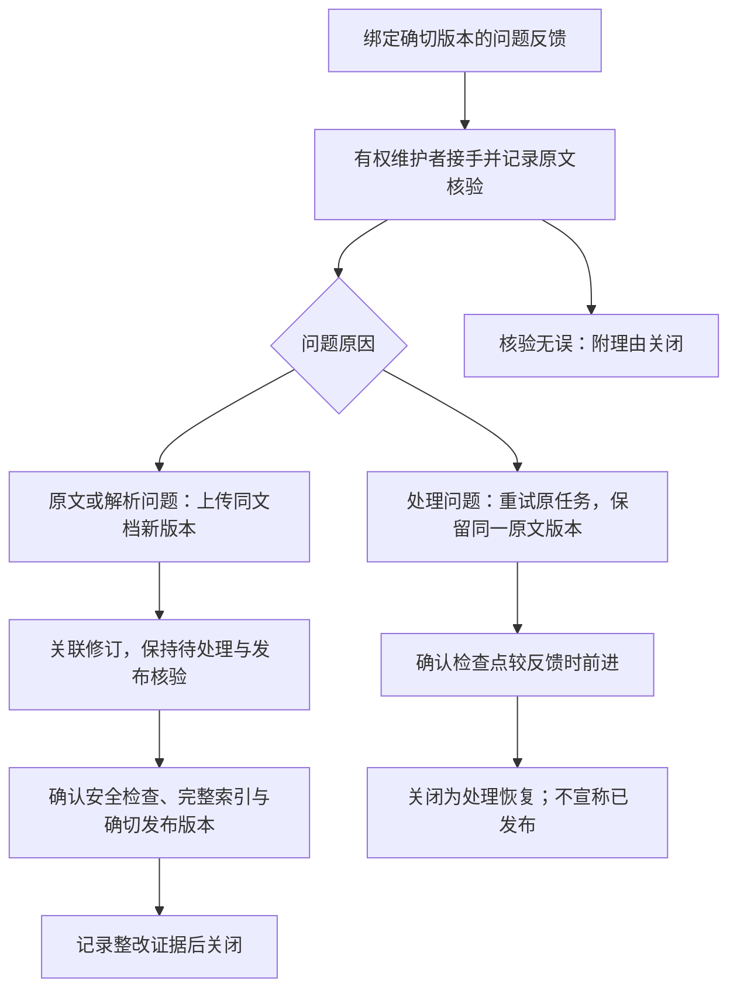

# P1-13 知识管理 UI 与人工纠错

日期：2026-11-07。已在现有知识库、文档/版本、上传、任务、解析/分块及索引页面上补齐版本问题反馈、责任人接手、人工核验、恢复/修订与审计。默认模型配置未改变；当前产品仍没有安全扫描和发布入口，修订记录会停留在待核验，不能通过纠错接口绕过发布门禁。

## 使用路径

1. 在知识库打开“文档与上传”，按名称和草稿/使用中/归档状态查找。文档“使用中”不冒充已发布，以具体版本的发布标记为准。
2. 查看版本、原文件、结构解析、质量提示、分块来源和索引状态。任务区区分原文件问题、服务/资源异常、等待依赖、权限变化与模型调用结果待核对。
3. 在具体版本打开“问题反馈与纠错”；也可从回答中定位原文后点击“报告这条来源的问题”，自动绑定确切版本和已验证结构块。
4. 读者提交原文/解析/处理问题，至少10个Unicode码点、最多2000 UTF-16字符。读者只看自己的反馈，维护者仅在当前授权范围处理。
5. 维护者填写动作说明并“由我接手”，再“记录原文核验”。核验绑定当前版本的不可变原文SHA-256、操作者与时间；它是操作者的人工声明，不冒充机器已经完成语义审查。
6. 根据原因选择同版本重试或上传较新修订，记录检查点/发布证据后关闭。核验无误可附理由关闭；关闭后重新打开会清除当前核验与整改关联，但历史审计完整保留。



反馈不会被自动当作事实、训练样本或新的解析结果。接口不覆盖原文件、原反馈、解析块或分块；内容修正通过不可变新版本进入正常处理链路。

## 状态与关闭证据

| 状态 | 含义 |
|---|---|
| open | 已登记，尚待接手 |
| in_progress | 有责任人核验/处理 |
| awaiting_validation | 已关联较新修订，仍待处理、安全检查与发布 |
| resolved | 已按相应问题类型核验证据；处理恢复不等于资料发布 |
| dismissed | 已人工核验并记录无需整改的理由 |

原文/解析问题：必须关联同文档、版本号更高的不可变版本。关闭时以PG当前发布指针核验该确切版本、clean原文、ready且完整的索引代际及完整收据数量；任一不足返回409，保留待核验状态。仅上传、解析完成或维护者写下“已经修复”都不能提前关闭。

处理问题：重试复用原job和version，经现有允许重试清单执行。关闭需证明处理已推进到比反馈时更高的检查点（解析、分块、索引或成功终态），且任务不处于排队、运行、失败或取消状态；记录job、run_no、stage与检查点，明确publication_confirmed=false。其余依赖是否恢复仍须查看当前任务，不伪装为整条链路已经完成。

涉及原文损坏、加密、OCR、无效编码等情况，界面建议核对并上传修订；服务/资源失败则在允许时重试同版本。分类是操作指引，不代替维护者核验。EMBEDDING_OUTCOME_UNKNOWN等不安全重试仍被原任务规则拒绝，不能从纠错入口强制重复模型调用。

## API 与并发

新增迁移009：correction_case、correction_event、correction_operation。所有接口认证，写操作要求Origin/CSRF；响应private/no-store、Vary Cookie/Authorization。

| 方法与路径 | 请求与行为 |
|---|---|
| POST /documents/:doc/versions/:version/corrections | kind、description、可选block_id；Idempotency-Key，201并返回ETag |
| GET /documents/:doc/versions/:version/corrections | limit/cursor/status；按当前权限与本人/维护者范围先过滤，再分页 |
| GET /corrections/:id | 当前可见详情、ETag及最近50条操作记录 |
| PATCH /corrections/:id | action、note、submit_fix时的replacement_version_id；首次写要求If-Match和Idempotency-Key |

kind仅source_content/extraction/processing。action仅claim/verify/retry/submit_fix/resolve/dismiss/reopen；没有传入负责人、核验人、状态、原文摘要或客户端整改证明的自由字段。

ETag为 `"correction:UUID:row_version"`。同键同载荷的重放先重新鉴权，再返回当前记录，不重执行；不同载荷409，首次缺少前置条件428，旧版本412。claim只将责任人设为当前有权维护者；改由另一位维护者接手必须重新核验，不能沿用原负责人的声明。

任务重试的既有事务逻辑已抽成受保护的同事务方法，供旧接口和纠错流程共同使用。原任务状态、轮次、操作幂等、纠错状态/事件及资源审计一次提交；插入纠错审计失败时整个重试回滚。没有“任务已经重试、纠错记录却未保存”的分步提交。页面保留未确认请求的幂等键，重试/索引重建也不因丢失响应自动换键。

创建与处理字段范围固定，SQL值参数化。数据库禁止UPDATE原反馈来源/正文和既有纠错事件；每次状态变化推进row_version，事件序号与版本同步。通用resource_audit保存动作、当前成员和request_id，详细动作说明保存在受保护的纠错事件中。

## 权限与隐私

提交需当前能读取该确切版本，结构块也必须属于它。普通读者仍只能访问当前已发布且clean的版本；编辑者的历史/草稿可见性沿用原规则。每次列表、详情、处理及幂等重放都重新读取PG成员、角色、KB/文档ACL、版本与安全状态，不依赖浏览器传入角色。

处理需有效doc.manage（已包含KB角色/ACL交集）；重试与提交新版本另外遵守既有write和任务权限。仅上传编辑者不能调用纠错管理操作，管理员没有资源ACL旁路。转交、撤权或角色降级后旧幂等键也不能恢复管理能力。

普通读者的DTO隐藏负责人ID、内部核验/整改说明、原文核验摘要、尚未发布的修订ID、整改证据和事件操作者/说明；只展示自己的原反馈和固定流程状态。维护者备注可能涉及未发布内容，不回显给原反馈读者。文档换版后，原版本不再对普通读者可见时，其关联反馈也统一不可访问，不泄露旧标题或内容。

人工核验不代替安全扫描，不修改scan_status；重试不发布资料；关联修订不创建文件或版本。真正的源文件下载仍单独校验download能力。当前没有全组织反馈浏览、通知发送、任意指派或反馈训练功能，后续反馈管理仍需独立实现。

## 员工指出制度答案错误时

先从回答定位原文并提交版本问题；维护者接手后对照原文件、适用范围和解析结构。若原文正确而回答选段错误，不能把员工纠正直接写成事实，应记录核验结论并交由基线评测定位生成问题。若原文或提取内容需修正，上传同文档新版本，核对新的解析/分块、处理任务及索引代际；必要时用现有索引页面显式重新校验，保留模型调用未知状态的保护。修订进入正常安全检查/发布后，才能以确切新版本和代际作为关闭证据，再用原问题复测。原文件和既有回答来源不被静默覆盖。

## 验证与运行

```sh
npm run db:migrate
npm run check
INDEX_PYTHON=/path/to/index-venv/bin/python npm run test:corrections
```

新增4项任务指引反例与14项纠错集成测试（含父测试），覆盖精确版本/块、私有反馈分页、读者/编辑者管理拒绝、CSRF、ETag与幂等、备注脱敏、关闭证据、不可变原件、重新打开、跨责任人核验、角色降级、未知模型调用禁止重试、审计故障原子回滚、Unicode最低字数以及重试不增加版本。集成使用真实PG、Redis、版本化开发S3、Worker与Milvus Lite；嵌入采用明确受控夹具，发布/扫描状态仅由隔离测试fixture准备。

Chromium桌面与390宽度实际完成：员工从回答来源报告问题、维护者接手/核验、读者看不到内部说明、上传新修订仍待发布、满足受信测试发布条件后关闭、损坏PDF与服务异常分流、同版本重试恢复且无重复版本、键盘提交与窄屏阅读。截图 `/tmp/zhiheng-p1-13.png`、`/tmp/zhiheng-p1-13-mobile.png` 为当前工作区临时验收产物。

本轮65项单元/基础检查与156项集成检查共221项通过，工作区类型检查、生产构建和迁移通过。模型夹具与测试发布条件不代表真实模型质量或业务事实已通过人工评审；既有真实模型与P1-12真人抽检待办保持未验收。
